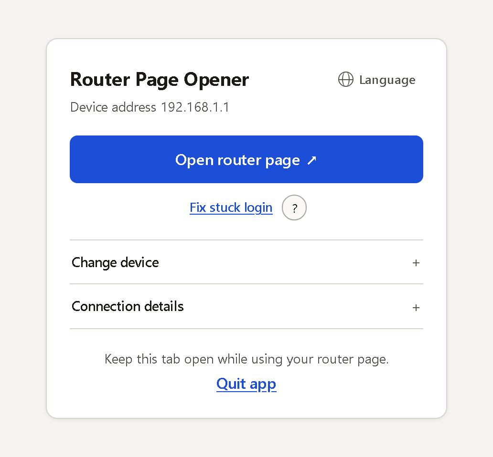

<p align="center">
  
</p>

<h1 align="center">Legacy Device &amp; Router Opener</h1>

<p align="center">
  Zero-dependency, offline Windows local TLS bridge for opening older routers, printers, switches, and server management consoles in modern browsers without Docker, Windows 7 VMs, or unpatched browsers.
</p>

<table align="center">
  <tr>
    <td align="center"></td>
    <td align="center"></td>
  </tr>
  <tr>
    <td align="center"><sub>English (Light)</sub></td>
    <td align="center"><sub>Arabic RTL (Dark)</sub></td>
  </tr>
</table>

## Quick Start (Windows)

1. Download `legacy-router-opener.exe` from [GitHub Releases](https://github.com/Alaa7Hany/legacy-router-page-opener/releases) and double-click it — no install or runtime needed.
2. Your browser opens `http://localhost:8180/_bridge` (with built-in **English & العربية RTL** toggle).
3. Click **Open router page** (`http://localhost:8080/`), or expand **Change device** to pick a target IP or profile.
4. Keep the opener tab open while using your device; closing the last opener tab stops the bridge after 4 seconds (or click **Quit app**).

> **Windows SmartScreen:** Release binaries are currently unsigned — click **More info** → **Run anyway**.
> Releases are built cleanly by GitHub Actions with `SHA256SUMS.txt` (`Get-FileHash .\legacy-router-opener.exe -Algorithm SHA256`).

## What It Fixes

Resolves `ERR_SSL_VERSION_OR_CIPHER_MISMATCH`, `SSL_ERROR_UNSUPPORTED_VERSION`, `ERR_SSL_UNSAFE_LEGACY_RENEGOTIATION_DISABLED`, `NET::ERR_CERT_AUTHORITY_INVALID`, and `ERR_CONNECTION_CLOSED`:

- **Routers & Access Points:** Older ISP and home routers — Huawei (`HG531`, `HG532n`, `HG630`, `DG8045`), ZTE (`ZXHN H108N`, `H168N`), D-Link, Netgear, TP-Link, and repurposed secondary Wi-Fi routers
- **Server Consoles:** HPE iLO 2 / 3 / 4 and Dell iDRAC 6 / 7
- **Switches & UPS:** Cisco / HP switches and firewalls, APC UPS (`NMC1` / `NMC2`)
- **Printers, NAS & Cameras:** HP LaserJet / Officejet EWS, QNAP / ReadyNAS, Hikvision / Dahua cameras

*Note:* Go's stdlib (`crypto/tls`) does not implement finite-field `DHE-RSA` or `SSLv3`; use plain HTTP (`:80`) or [`desktop/legacy/index.mjs`](desktop/legacy/index.mjs) for those devices, and see [Troubleshooting & Protocol Matrix](desktop/docs/troubleshooting-and-device-modes.md) for the full matrix.

## Security at a Glance

- **Loopback-only:** Listens exclusively on `127.0.0.1` and `[::1]`.
- **Origin isolation:** Control/quit endpoints (`:8180`) stay isolated from the proxied device (`:8080`) with strict `Host`, `Origin`, CSRF, and CSP enforcement.
- **Zero persistence:** Zero telemetry, zero disk writes, and zero modifications to browser settings.

## Build & Docs

```powershell
cd desktop
go test ./...
.\build.ps1 -Version 0.9.0
```

Docs: [How It Works](desktop/docs/how-it-works.md) · [Design Decisions](desktop/docs/design-and-platform-decisions.md) · [Troubleshooting & CLI Flags](desktop/docs/troubleshooting-and-device-modes.md)

## Android

[`android/`](android/) is in-repo and currently being refactored for an upcoming release.

## Support & License

Optional support: [Ko-fi](https://ko-fi.com/lol7harrr) · [GitHub Sponsors](https://github.com/sponsors/Alaa7Hany)

Licensed under **GNU GPLv3** — see [LICENSE](LICENSE).
