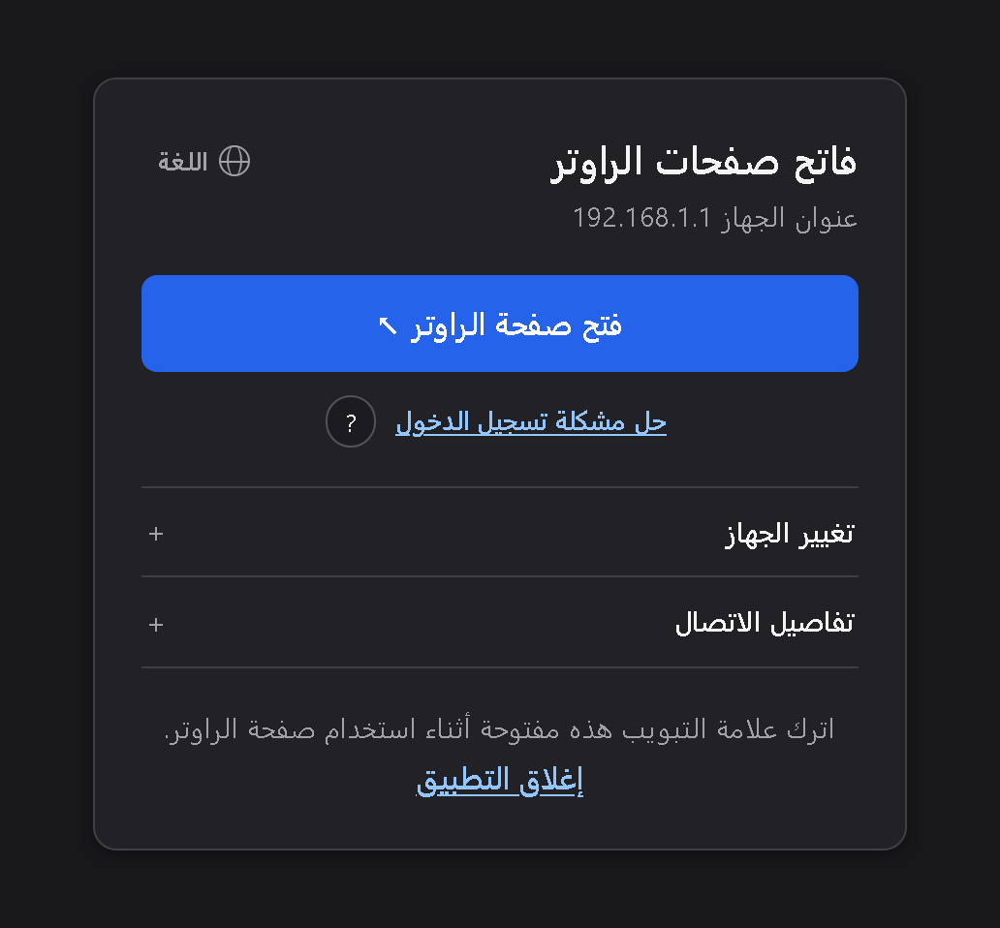

<p align="center">
  
</p>

<h1 align="center">Legacy Device &amp; Router Opener</h1>

<p align="center">
  Zero-dependency, offline local TLS bridge for Windows and Android for opening older routers, printers, switches, and server management consoles in modern browsers without Docker, Windows 7 VMs, or unpatched browsers.
</p>

<table align="center">
  <tr>
    <td align="center"></td>
    <td align="center"></td>
  </tr>
  <tr>
    <td align="center"><sub>English (Light)</sub></td>
    <td align="center"><sub>Arabic RTL (Dark)</sub></td>
  </tr>
</table>

## Quick Start

### Windows

1. Download `legacy-router-opener.exe` from [GitHub Releases](https://github.com/Alaa7Hany/legacy-router-opener/releases) and double-click it — no install or runtime needed.
2. Your browser opens `http://localhost:8180/_bridge` (with built-in **English & العربية RTL** toggle).
3. Click **Open router page** (`http://localhost:8080/`), or expand **Change device** to pick a target IP or profile.
4. Keep the opener tab open while using your device; closing the last opener tab stops the bridge after 4 seconds (or click **Quit app**).

> **Windows SmartScreen:** Release binaries are currently unsigned — click **More info** → **Run anyway**.
> Releases are built cleanly by GitHub Actions with `SHA256SUMS.txt` (`Get-FileHash .\legacy-router-opener.exe -Algorithm SHA256`).

### Android (Android 8.0+ / API 26+)

1. Download `legacy-router-opener.apk` from [GitHub Releases](https://github.com/Alaa7Hany/legacy-router-opener/releases) and install it (or run `adb install legacy-router-opener.apk`).
2. Tap **Open router page** to use the built-in viewer, or **Open in external browser** (Chrome, Edge, Firefox, Samsung Internet) — includes a built-in **English & العربية RTL** toggle.
3. Expand **Change device** to pick a target IP or device profile; tap **Stop local proxy** (in-app or from the notification) when done.

> **APK Verification:** Verify downloads against `SHA256SUMS.txt` and the official APK signing certificate SHA-256 fingerprint:
> `28c3e864cf3aa9005bbe38bff68a2b152e256d18940e2189d7bc7987b5a26fb4`

## What It Fixes

Resolves `ERR_SSL_VERSION_OR_CIPHER_MISMATCH`, `SSL_ERROR_UNSUPPORTED_VERSION`, `ERR_SSL_UNSAFE_LEGACY_RENEGOTIATION_DISABLED`, `NET::ERR_CERT_AUTHORITY_INVALID`, `ERR_SSL_WEAK_SERVER_EPHEMERAL_DH_KEY`, and `ERR_CONNECTION_CLOSED`:

- **Routers & Access Points:** Older ISP and home routers — Huawei (`HG531`, `HG532n`, `HG630`, `DG8045`), ZTE (`ZXHN H108N`, `H168N`), D-Link, Netgear, TP-Link, and repurposed secondary Wi-Fi routers
- **Server Consoles:** HPE iLO 2 / 3 / 4 and Dell iDRAC 6 / 7
- **Switches & UPS:** Cisco / HP switches and firewalls, APC UPS (`NMC1` / `NMC2`)
- **Printers, NAS & Cameras:** HP LaserJet / Officejet EWS, QNAP / ReadyNAS, Hikvision / Dahua cameras

*Protocol coverage:*
- **Windows (`.exe`):** TLS 1.0–1.3, 1024-bit RSA/SHA-1, `RC4`, `3DES`, and unsafe legacy renegotiation. Go's stdlib (`crypto/tls`) does not implement finite-field `DHE-RSA` or `SSLv3` — use plain HTTP (`:80`), [`desktop/legacy/index.mjs`](desktop/legacy/index.mjs), or the **Android app** for those devices.
- **Android (`.apk`):** Bundled Bouncy Castle legacy TLS engine covering TLS 1.0–1.3, `SSLv3`, `512-bit`/`768-bit DHE-RSA` (`DH_KEY_TOO_SMALL`), `RC4`/`3DES`, and pre-RFC-5746 unsafe renegotiation — no root, no VPN, and no browser setting changes.

See [Troubleshooting & Protocol Matrix](desktop/docs/troubleshooting-and-device-modes.md) for the full matrix.

## Security at a Glance

- **Loopback-only:** Listens exclusively on loopback (`127.0.0.1` / `[::1]` on Windows; `127.0.0.1` on Android).
- **Origin isolation:** Windows isolates control/quit endpoints (`:8180`) from the proxied device (`:8080`) with strict `Host`, `Origin`, CSRF, and CSP enforcement; Android issues a fresh random `<hex>.localhost` origin per session and clears retired cookies/storage on switch or reset.
- **Offline & private:** Zero telemetry, zero analytics, zero ads, and no modifications to system or browser settings.

## Build & Docs

### Windows
```powershell
cd desktop
go test ./...
.\build.ps1 -Version 1.0.0
```

### Linux
```bash
cd desktop
go test ./...
./build.sh 1.0.0
# or, using the Makefile:
make test
make build VERSION=1.0.0
```

### Android
```bash
cd android
./gradlew testDebugUnitTest assembleRelease
```

### Makefile (desktop)
The desktop module ships a `Makefile` for convenience:
```bash
cd desktop
make            # build for Linux (default)
make test       # run Go tests
make run        # run with --no-browser
make build-windows VERSION=1.0.0
make clean
```

### Hot reload (development)
Install [Air](https://github.com/air-verse/air) and run from `desktop/`:
```bash
go install github.com/air-verse/air@latest
air
```

- **Desktop Docs:** [How It Works](desktop/docs/how-it-works.md) · [Design Decisions](desktop/docs/design-and-platform-decisions.md) · [Troubleshooting & CLI Flags](desktop/docs/troubleshooting-and-device-modes.md)
- **Android Docs:** [Overview](android/docs/README.md) · [How It Works](android/docs/how-it-works.md) · [Design Decisions](android/docs/design-and-platform-decisions.md) · [Troubleshooting](android/docs/troubleshooting.md)

## Support & License

Optional support: [Ko-fi](https://ko-fi.com/lol7harrr) · [GitHub Sponsors](https://github.com/sponsors/Alaa7Hany)

Licensed under **GNU GPLv3** — see [LICENSE](LICENSE).
